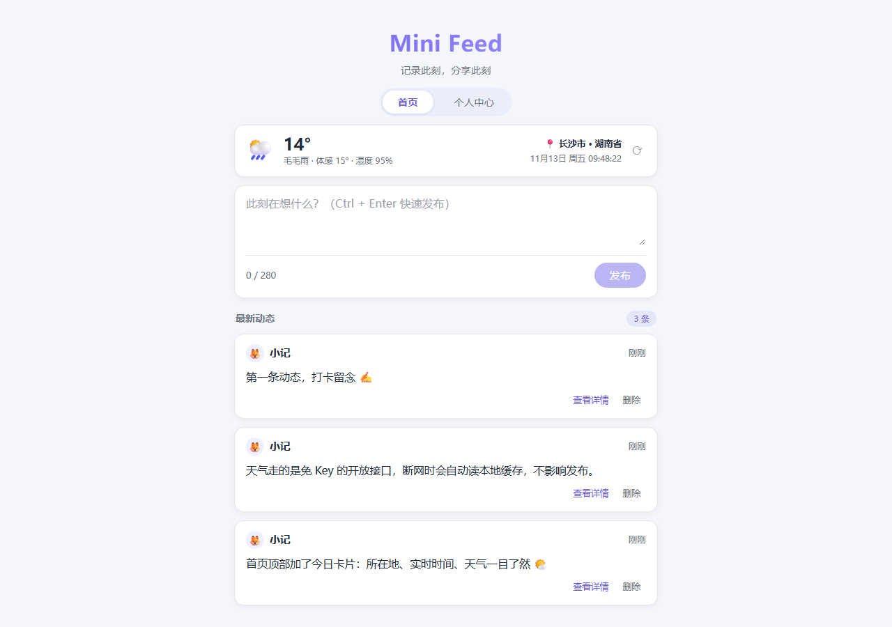
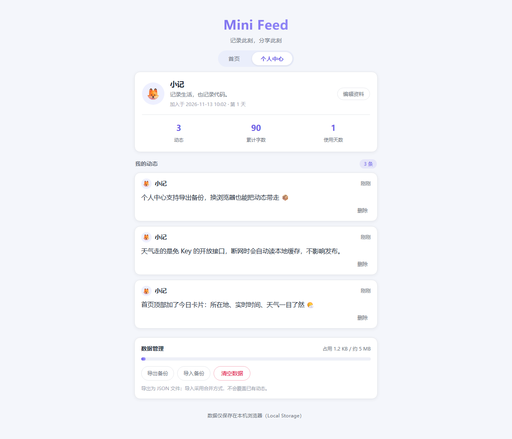
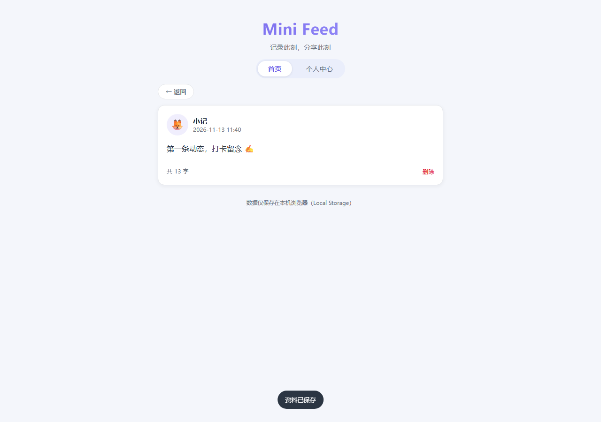
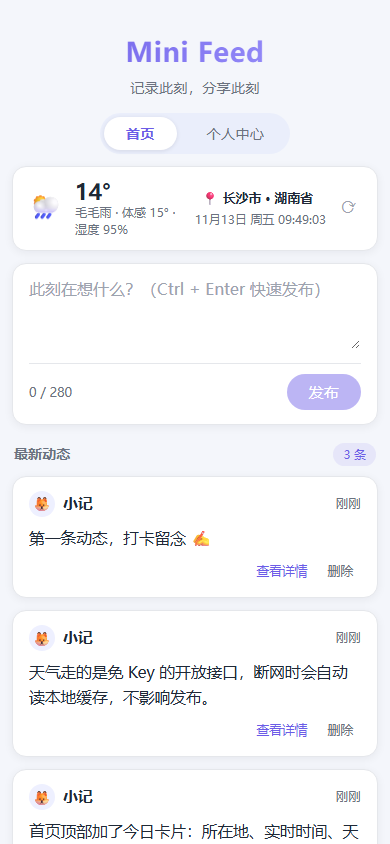

# Mini Feed

一个极简的社交动态（micro-feed）应用：纯 HTML + CSS + JavaScript 实现，零依赖、零构建，数据通过浏览器 **Local Storage** 本地化存储，刷新不丢失。

> 建议通过本地服务器访问（如 `python -m http.server`），部分浏览器直接用 `file://` 打开时会禁用本地存储，详见 [常见问题](#-常见问题)。
> 首页顶部的天气卡片需要联网获取数据（全部为免 Key 开放接口），断网时自动降级为缓存或占位提示。

## 📌 项目需求说明

| 需求项 | 实现情况 |
| --- | --- |
| 纯 HTML + CSS + JavaScript，不使用任何框架 | ✅ 原生三件套，零依赖 |
| 发布动态 | ✅ 文本输入 + 发布按钮，支持 Ctrl/Cmd + Enter 快捷键 |
| 查看动态 | ✅ 时间线倒序展示 + 单条动态详情页（完整正文 / 精确时间 / 字数） |
| 所在地 / 当前时间 / 天气 | ✅ 首页顶部「今日卡片」：自动 IP 定位 + 实时天气，时间每秒走动 |
| 本地化数据存储 | ✅ `localStorage` 持久化，关闭浏览器后数据保留 |
| 删除动态 | ✅ 列表与详情页均可删除（带确认提示） |
| 个人中心 | ✅ 头像 / 昵称 / 简介编辑、数据统计、我的动态、清空数据 |
| 最小可用 | ✅ 单页应用，三个文件即可完整运行 |

## ✨ 功能清单（V1.2）

**🌤️ 今日卡片（首页顶部）**
- 📍 **所在地**：通过 IP 自动定位，反向地理编码为中文地名（如「长沙市 · 湖南省」），定位结果缓存 12 小时
- 🕒 **当前时间**：月/日 + 星期 + 时分秒，每秒实时走动
- 🌡️ **天气**：实时温度、天气现象（晴 / 多云 / 雨 / 雪 / 雷阵雨…）、体感温度、湿度，配 WMO 天气代码对应的图标
- 🔄 **刷新**：右上角一键刷新；天气缓存 20 分钟，过期自动更新
- 🛟 **容错**：定位主源被限流时自动切换备源；全部接口不可用时读取本地缓存并标注「离线缓存」，完全失败仅显示占位提示，**不影响发布与查看**

**🏠 首页**
- ✏️ **发布**：多行文本输入，280 字上限，实时字数统计，空内容禁止发布，发布后新卡片高亮
- 📜 **时间线**：新动态置顶，头像 + 昵称 + 相对时间（刚刚 / N 分钟前 / …），顶部显示动态总数
- 👀 **查看详情**：点击卡片或「查看详情」进入详情页，展示完整正文、精确发布时间与字数
- 🗑️ **删除**：列表单条删除，二次确认防误触

**👤 个人中心**
- 🖼️ **资料编辑**：昵称（≤20 字）、简介（≤60 字）、10 款头像 emoji 可选，保存后全局同步
- 📊 **数据统计**：动态数 / 累计字数 / 使用天数（自动计算）
- 📝 **我的动态**：独立列表，可删除或查看详情
- 🧹 **清空数据**：一键清除所有动态与资料（带确认提示）

**🔧 稳健性**
- 💾 **存储降级**：`localStorage` 被禁用时自动降级为内存存储并给出提示条，不会因异常导致发布失败
- 🛡️ **安全**：用户内容统一通过 `textContent` 渲染，天然防 XSS
- 📱 **响应式**：640px 居中布局，移动端自适应
- ⌨️ **快捷键**：Ctrl/Cmd + Enter 发布，Esc 关闭表单 / 返回列表

## 🗂️ 项目结构

```
mini-feed-20261113/
├── index.html      # 页面结构（首页 / 个人中心 / 详情 三视图）
├── style.css       # 样式（卡片式 UI，浅色主题）
├── weather.js      # 今日卡片（IP 定位 / 中文地名 / 天气 / 实时时钟）
├── app.js          # 逻辑（存储层 / 渲染 / 视图切换 / 业务操作）
├── screenshots/    # 运行效果截图
└── README.md
```

## 🚀 本地运行

推荐使用静态服务器：

```bash
python -m http.server 8000
# 或
npx serve .
```

然后访问 `http://localhost:8000`。

也可以直接双击 `index.html` 打开（若浏览器限制 `file://` 的本地存储，页面顶部会提示数据仅本次会话有效）。

## 📸 实现效果

**首页（桌面端）**



**个人中心**



**动态详情**



**移动端**



## ❓ 常见问题

**Q：双击打开后，页面只有发布框，发布的内容不显示？**
A：这是浏览器对 `file://` 协议的本地存储限制导致的（Chrome/Edge 部分安全策略下 `localStorage` 访问会被直接拒绝）。
V1.1 已修复：存储不可用时会自动降级为内存模式并在页面顶部提示，发布与查看均正常，只是关闭页面后数据不保留。
如需真正持久化，请用 `python -m http.server 8000` 以 `http://localhost:8000` 访问。

**Q：天气卡片一直显示「天气暂不可用」？**
A：天气依赖公网接口，需要联网访问。常见原因：断网 / 接口被网络环境拦截 / IP 定位服务临时限流。
点击卡片右上角 ⟳ 可重试；接口恢复后会自动展示，历史数据会在离线时作为缓存兜底显示。

## 🌐 天气数据来源

天气卡片全部使用**免 Key、支持跨域**的开放接口，无任何后端与密钥配置：

| 用途 | 接口 | 说明 |
| --- | --- | --- |
| IP 定位（主） | `ipinfo.io/json` | 返回经纬度，写入 12 小时定位缓存 |
| IP 定位（备） | `ipwho.is` | 主源限流时自动切换 |
| 中文地名 | `api.bigdatacloud.net/data/reverse-geocode-client?localityLanguage=zh` | 经纬度 → 中文省市区 |
| 实时天气 | `api.open-meteo.com/v1/forecast` | 温度、体感温度、湿度、WMO 天气代码 |

定位仅用于确定天气城市，不会上传任何用户输入内容；动态与个人资料始终只存在本机 `localStorage`。

## 🛣️ 后续迭代路线（Roadmap）

以下功能与现有架构不冲突，可逐步叠加：

- [x] 个人资料：昵称、简介、头像
- [x] 动态详情页
- [ ] 编辑已发布的动态
- [ ] 点赞 / 收藏
- [ ] 图片附件（Base64 存入 Local Storage）
- [ ] 动态搜索与标签
- [ ] 数据导出 / 导入（JSON）
- [ ] 深色模式切换

## 📝 版本记录

- **V1.2（2026-11-13）**：首页顶部新增「今日卡片」——所在地（IP 自动定位 + 中文地名）、当前时间（每秒走动）、实时天气（温度 / 天气现象 / 体感 / 湿度）；多源定位容错与离线缓存降级。
- **V1.1（2026-11-13）**：修复浏览器禁用本地存储时「发布后无内容」的问题（存储降级 + 提示条）；新增个人中心（资料编辑 / 统计 / 我的动态 / 清空数据）；新增动态详情页；新增动态计数与发布高亮。
- **V1.0（2026-11-13）**：首个可用版本，支持发布、时间线查看、删除与 `localStorage` 持久化。

## 📄 说明

本项目仅用于学习交流，所有数据仅保存在使用者本机浏览器中，不涉及任何服务端与隐私上传。
