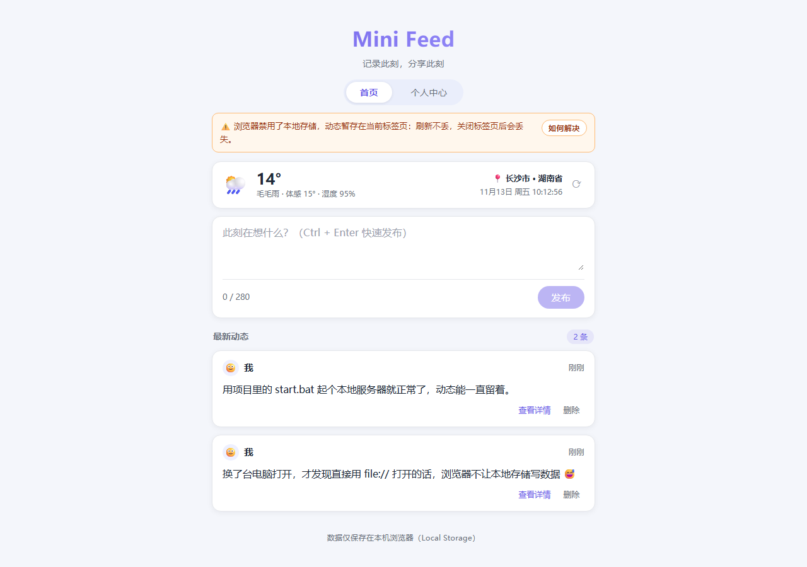
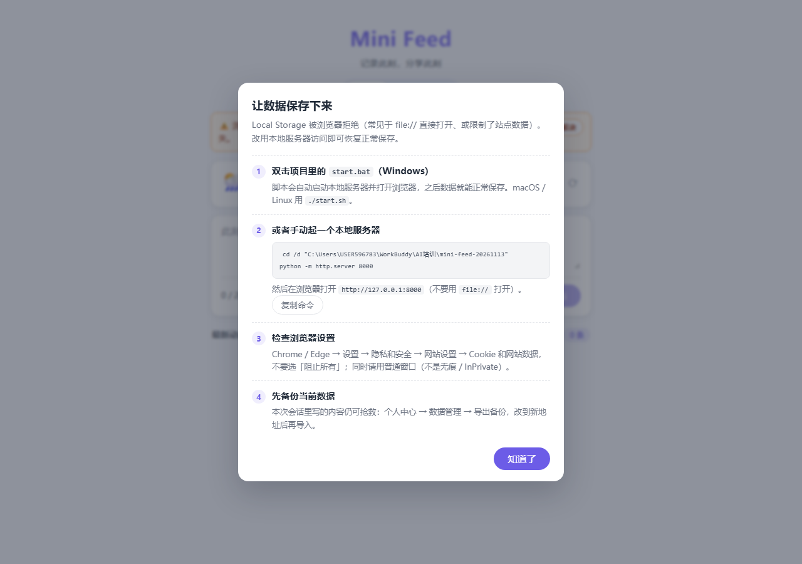

# Mini Feed

一个极简的社交动态（micro-feed）应用：**Vue 3 + Pinia** 实现，数据通过浏览器 **Local Storage** 本地化存储，零后端、零账号，刷新不丢失。

> 本项目的 V2 是对 V1（纯 HTML/CSS/JS）的 **TDD 重写**：先写测试，再写实现。重写前的版本保存在 git tag `v1.4-vanilla`。

## 📌 项目需求说明

| 需求项 | 实现情况 |
| --- | --- |
| 使用 Node.js + Vue 3 实现 | ✅ Vite 7 + Vue 3.5（Composition API + `<script setup>`） |
| 使用 Pinia 管理状态 | ✅ 3 个 store：posts / profile / weather |
| 使用 Local Storage 存储数据 | ✅ 四级降级存储层，可跨会话持久化 |
| 发布动态 | ✅ 文本输入 + 发布按钮，支持 Ctrl/Cmd + Enter 快捷键 |
| 查看动态 | ✅ 时间线倒序展示 + 单条详情（完整正文 / 精确时间 / 字数） |
| 所在地 / 当前时间 / 天气 | ✅ 首页顶部「今日卡片」，IP 自动定位 + 实时天气，时钟每秒走动 |
| 删除动态 | ✅ 列表与详情页均可删除（带确认） |
| 个人中心 | ✅ 资料编辑、数据统计、我的动态、数据管理 |
| 数据备份 | ✅ 导出 JSON / 导入合并 / 清空数据 |
| TDD 开发 | ✅ 先写测试再实现，**376 个用例全部通过** |
| 保证项目无问题 | ✅ 全量测试 + 生产构建 + 真实浏览器端到端验收 |

## 🧪 测试与质量

```bash
npm test           # 一次性跑完全部测试
npm run test:watch # 监听模式（TDD 开发时用）
npm run test:cov   # 带覆盖率
```

**376 个测试用例**，分布在 28 个测试文件，按层次组织：

| 层次 | 覆盖对象 | 用例数 |
| --- | --- | --- |
| 纯函数 | `time` `bytes` `post` `backup` `weather-code` | 65 |
| 服务 | `storage`（四级降级）`storage-shim`（白屏修复）`weather-api` `storage-context` | 53 |
| 状态 | `posts` / `profile` / `weather` 三个 store | 59 |
| 编排 | `useDataBackup` `useStorageMeter` `useClock` `useToast` `useConfirm` | 52 |
| 组件 | 11 个组件（发布框 / 卡片 / 列表 / 今日卡片 / 个人中心 / 数据管理 / 详情 / 告警 / 帮助面板 / 标签栏） | 117 |
| 集成 | `App` 端到端用户流程 | 30 |
| **合计** | | **376** |

测试策略：**黑盒为主**（用 `data-testid` 定位，通过 DOM 交互与事件断言），只替换网络与时间，业务逻辑全部真实执行。

## ✨ 功能清单

**🌤️ 今日卡片（首页顶部）**
- 📍 **所在地**：IP 自动定位 → 反向地理编码为中文地名（如「长沙市 · 湖南省」），缓存 12 小时
- 🕒 **当前时间**：月/日 + 星期 + 时分秒，每秒实时走动
- 🌡️ **天气**：温度、天气现象、体感温度、湿度，配 WMO 代码对应的图标
- 🔄 **刷新**：右上角一键刷新；天气缓存 20 分钟，过期自动更新
- 🛟 **容错**：定位主源限流时自动切备源；全部失败时读缓存并标注，完全失败仅显示占位——**不影响发布**

**🏠 首页**
- ✏️ **发布**：280 字上限、实时字数计数、空内容禁发、接近上限变色提醒、发布后新卡片高亮
- 📜 **时间线**：新动态置顶，头像 + 昵称 + 相对时间（刚刚 / N 分钟前 / …）
- 👀 **查看详情**：完整正文、精确时间（2026-11-13 11:38）、字数统计
- 🗑️ **删除**：二次确认防误触

**👤 个人中心**
- 🖼️ **资料编辑**：昵称（≤20 字）、简介（≤60 字）、10 款头像，保存后全局同步到所有卡片
- 📊 **数据统计**：动态数 / 累计字数 / 使用天数（按自然日自动计算）
- 📝 **我的动态**：独立列表，可查看详情或删除
- 📦 **数据管理**：存储占用可视化（70% 转橙、90% 转红预警）、导出 JSON 备份、导入备份（合并去重 + 资料保护）、清空数据

**🔧 稳健性**
- 💾 **存储四级降级**：`localStorage` → `sessionStorage` → `window.name` → 内存。任一环节被浏览器拒绝都不会中断发布；提示条会说明数据能活多久，并提供「如何解决」自助排查面板
- 🛡️ **防第三方库崩溃**：`storage-shim` 在 Pinia 之前把被拦截的存储换成安全替身（详见 [常见问题](#-常见问题)）
- 🔒 **防 XSS**：用户内容统一走插值渲染（等价 `textContent`），从不使用 `v-html`
- 📱 **响应式**：640px 居中布局，移动端自适应
- ⌨️ **快捷键**：Ctrl/Cmd + Enter 发布，Esc 关闭表单 / 返回列表

## 🗂️ 项目结构

```
mini-feed-20261113/
├── index.html                 # 入口 HTML（挂载点）
├── vite.config.js             # Vite + Vitest 配置
├── start.bat / start.sh       # 一键启动（自动装依赖 + 起服务 + 开浏览器）
├── src/
│   ├── main.js                # 应用入口（storage-shim 必须最先导入）
│   ├── App.vue                # 根组件：视图编排 + 跨领域动作协调
│   ├── assets/main.css        # 全局样式：设计变量、重置、通用类
│   ├── components/            # 11 个展示组件（各自带 .spec.js）
│   │   ├── TabBar.vue         #   顶部视图切换
│   │   ├── TodayCard.vue      #   今日卡片（地点/时间/天气）
│   │   ├── PostComposer.vue   #   发布框
│   │   ├── PostCard.vue       #   动态卡片
│   │   ├── PostList.vue       #   动态列表 + 空状态
│   │   ├── PostDetail.vue     #   动态详情
│   │   ├── ProfilePanel.vue   #   资料展示与编辑
│   │   ├── DataManager.vue    #   存储占用 + 备份操作
│   │   ├── StorageWarning.vue #   存储降级告警条
│   │   ├── StorageHelp.vue    #   存储问题自查面板
│   │   └── AppToast.vue       #   轻量提示
│   ├── composables/           # 有状态的跨组件能力
│   │   ├── useDataBackup.js   #   导出/导入/清空（跨 posts+profile）
│   │   ├── useStorageMeter.js #   存储占用与阈值
│   │   ├── useClock.js        #   每秒时钟
│   │   ├── useToast.js        #   提示条
│   │   └── useConfirm.js      #   确认对话框（可注入、环境安全）
│   ├── services/              # 外部依赖隔离层
│   │   ├── storage.js         #   四级降级存储
│   │   ├── storage-shim.js    #   存储访问保护垫片
│   │   ├── storage-context.js #   存储单例（便于测试替换）
│   │   └── weather-api.js     #   定位 + 天气（fetch 可注入）
│   ├── stores/                # Pinia
│   │   ├── posts.js           #   动态
│   │   ├── profile.js         #   个人资料
│   │   └── weather.js         #   天气与缓存
│   ├── utils/                 # 纯函数
│   │   ├── time.js            #   相对/精确/时钟/天数
│   │   ├── post.js            #   创建/校验/排序/去重
│   │   ├── backup.js          #   备份构建与解析
│   │   ├── bytes.js           #   字节格式化
│   │   └── weather-code.js    #   WMO 码映射
│   └── test/setup.js          # 测试环境准备
└── screenshots/               # 运行效果截图
```

**分层约定**：纯函数 → 服务 → store → composable → 组件。依赖只能从上往下指向，组件只上报意图、不直接改状态。

## 🚀 本地运行

### 方式一：一键启动（推荐）

| 系统 | 操作 |
| --- | --- |
| Windows | 双击 `start.bat` |
| macOS / Linux | 终端执行 `./start.sh` |

脚本会自动检查 Node、按需安装依赖、启动服务并打开浏览器。

### 方式二：手动启动

```bash
npm install
npm run dev      # 开发服务器 → http://127.0.0.1:5173
npm run build    # 生产构建 → dist/
npm run preview  # 预览构建产物
```

## 📸 实现效果

**首页（桌面端）**


**个人中心**


**动态详情**


**移动端**


**存储受限时的提示条（自动降级说明）**



**「如何解决」自助排查面板**



## ❓ 常见问题

**Q：页面顶部提示「浏览器禁用了本地存储，动态暂存在当前标签页」，怎么办？**
A：说明浏览器拒绝了站点数据写入。点提示条右侧「如何解决」，面板里有可一键复制的命令与浏览器设置检查清单。最省事的办法是用 `start.bat` / `start.sh` 启动，通过 `http://` 访问。

即便在这种受限状态下应用也不会崩：数据会依次退到 `sessionStorage` → 标签页级容器 → 内存，**刷新不丢**，只是关闭标签页后清空。想留住内容可先「导出备份」。

**Q：为什么需要 `storage-shim`？**
A：这是一个真实踩到的坑。某些浏览器策略会让 `window.localStorage` 的**访问器本身抛异常**，此时连 `typeof localStorage` 都会崩。而 Pinia 内置的 devtools 代码正是这样写的：

```js
if (typeof localStorage === "undefined" || localStorage === null) return {...}
```

守卫自身抛错 → Pinia 模块求值失败 → **Vue 应用完全无法挂载（白屏）**。
`storage-shim` 在任何第三方库之前把这种存储替换成可安全访问的内存替身，让第三方库不再崩；同时应用自己的存储层会识别出「这不是真存储」并如实降级提示。

**Q：天气卡片显示「天气暂不可用」？**
A：天气依赖公网接口。常见原因是断网、接口被网络环境拦截或 IP 定位服务限流。点击卡片右上角 ⟳ 重试；历史数据会在离线时作为缓存兜底显示。

**Q：换浏览器 / 换设备后动态还在吗？**
A：不会自动同步（数据只在本机浏览器）。在旧环境「个人中心 → 导出备份」下载 JSON，再到新环境「导入备份」即可。
导入采用**合并**方式：按「内容 + 时间」去重，不覆盖已有动态；只有当本地资料仍是默认值时才恢复昵称/简介/头像。

**Q：备份文件长什么样？**
A：标准 JSON，可自行编辑或二次处理：

```json
{
  "app": "minifeed",
  "version": 1,
  "exportedAt": "2026-11-13T03:38:00.000Z",
  "profile": { "name": "小记", "bio": "记录生活，也记录代码。", "avatar": "🦊", "joinedAt": 1794535200000 },
  "posts": [{ "id": "mfabc123", "text": "第一条动态", "createdAt": 1794534951738 }]
}
```

## 🌐 天气数据来源

全部使用**免 Key、支持跨域**的开放接口，无后端与密钥配置：

| 用途 | 接口 | 说明 |
| --- | --- | --- |
| IP 定位（主） | `ipinfo.io/json` | 返回经纬度，写入 12 小时定位缓存 |
| IP 定位（备） | `ipwho.is` | 主源限流时自动切换 |
| 中文地名 | `api.bigdatacloud.net/data/reverse-geocode-client?localityLanguage=zh` | 经纬度 → 中文省市区 |
| 实时天气 | `api.open-meteo.com/v1/forecast` | 温度、体感、湿度、WMO 天气代码 |

定位仅用于确定天气城市，不会上传任何用户输入；动态与个人资料始终只存在本机 `localStorage`。

## 🔬 TDD 实践记录

开发顺序（每一步都是「先写测试 → 看它失败 → 写实现 → 转绿」）：

1. **存储层** → 测试先失败（模块不存在），实现后 16 个用例转绿
2. **纯函数** → 时间 / 字节 / 动态 / 备份 / 天气码，共 65 个用例
3. **store** → posts（23）/ profile（21）/ weather（15）
4. **composable** → 备份编排、存储计量、时钟
5. **组件** → 11 个组件逐个 TDD，共 117 个用例
6. **集成** → App 端到端用户流程（30 个用例）

**测试真正抓到的 3 个 bug**（都是实现缺陷，不是测试写法问题）：

| # | 问题 | 表现 | 修复 |
| --- | --- | --- | --- |
| 1 | 写入失败后退回内存，但 `read` 只查存储区 | 配额满时写入的值读不回来 | `read` 在存储区无值时继续查内存副本 |
| 2 | 保存按钮被 `submit` 与 `click` 双重触发 | 表单状态被第二次调用翻转，重复上报 | 用 `editing` 作为守卫保证幂等 |
| 3 | 含 ref 的对象整体作为 prop 传递 | 进度条满格、预警色失效（对象字面量不解包 ref） | 在 `App.vue` 用 `computed` 解包成普通值 |

**另外在浏览器端到端验收中发现 2 个 bug**（单元测试覆盖不到，因为测试都注入了存储替身）：

| # | 问题 | 修复 |
| --- | --- | --- |
| 4 | 禁用 localStorage 时**整页白屏**（Pinia devtools 读存储抛错，模块加载失败） | 新增 `storage-shim` 保护垫片 + 18 个回归测试 |
| 5 | 存储进度条满格（ref 未解包） | `App.vue` 解包为普通值 + 3 个回归测试 |

> 这 5 个修复都有回归测试锁死，避免将来再次出现。

## 🛣️ 后续迭代路线（Roadmap）

- [x] 个人资料：昵称、简介、头像
- [x] 动态详情页
- [x] 数据导出 / 导入（JSON）
- [x] Vue 3 + Pinia 重写（TDD）
- [ ] 编辑已发布的动态
- [ ] 点赞 / 收藏
- [ ] 图片附件（Base64 存入 Local Storage）
- [ ] 动态搜索与标签
- [ ] 深色模式切换

## 📝 版本记录

- **V2.0（2026-11-13）**：以 TDD 方式重写为 Node.js + Vue 3 + Pinia。新增 Vite 构建、376 个测试用例、`storage-shim` 存储保护（修复禁用存储时白屏）、组件化拆分与分层架构；V1 功能全部保留（今日卡片、个人中心、数据管理等）。
- **V1.4（2026-11-13）**：纯 HTML/CSS/JS 版本。新增 `start.bat` / `start.sh` 一键启动；存储层四级降级；存储提示条与自助排查面板。
- **V1.3（2026-11-13）**：个人中心新增「数据管理」——存储占用可视化、JSON 备份导出、导入（合并去重 + 资料保护 + 非法文件校验）。
- **V1.2（2026-11-13）**：首页顶部新增「今日卡片」——所在地、当前时间、实时天气。
- **V1.1（2026-11-13）**：修复存储被禁时「发布后无内容」；新增个人中心与动态详情页。
- **V1.0（2026-11-13）**：首个可用版本，支持发布、时间线查看、删除与 Local Storage 持久化。

### 历史版本

重写前的纯 HTML/CSS/JS 版本可通过 tag 获取：

```bash
git checkout v1.4-vanilla
```

## 📄 说明

本项目仅用于学习交流，所有数据仅保存在使用者本机浏览器中，不涉及任何服务端与隐私上传。
